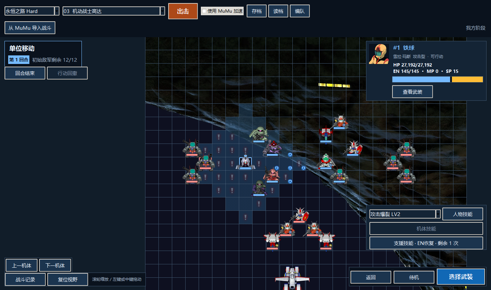

# GGET 战斗模拟

这个项目包含《SD 高达 G 世纪 永恒》的本地战斗模拟。桌面窗口通过独立 ARM64 进程调用原版战斗服务，支持手动操作、战斗存档和 MuMu 续战。

**[图文使用说明](docs/USER_GUIDE.md)**



## Windows 一键配置

1. 在 Windows x64 电脑上从 [发布页](https://github.com/Torfaen/gget-battle-simulator/releases) 选择轻量包或全量包，解压后双击 `setup.cmd`。也可从代码仓库运行同一个脚本。
2. 全量包自带界面、战斗和机体立绘资源。轻量包首次配置时会从公开资源 Release 自动下载这三份 ZIP，无需 GitHub 登录。脚本校验 SHA-256、配置 Python、Zig 和战斗后端，再生成本地测试编队。缺少系统工具时会通过 WinGet 引导安装，首次配置仍需联网下载缺少的依赖。
3. 窗口打开后，选择「永恒之路 Hard」的「机动战士高达」，点击「出击」。脚本会优先使用可连接的 MuMu，其他情况下会准备 Windows 独立运行的 QEMU 后端。

首次配置默认使用程序旁边的 `gget-battle-simulator-local`。从旧版本升级时，启动器会查找旁边已安装的数据目录。旧目录在其他位置，或同级有多个旧目录时，首次新版启动用 `-DataDir` 指到原 `setup.log` 所在目录，之后双击会沿用这个位置。配置日志也写在该目录的 `setup.log`。

启动器在打开战斗窗口前检查更新清单，按 SHA-256 复用本机已有的程序和界面资源，只下载发生变化的文件。连不上网络时可以继续启动已安装的版本。有现成的资源 ZIP 时，可以指定其目录。资源包和校验值见 [资源发布页](https://github.com/Torfaen/gget-battle-simulator-resources/releases/tag/2026.11.16)。

```powershell
.\setup.cmd -DataDir 'D:\GGET-battle-local' -ResourceArchiveDir 'D:\Downloads' -Backend QEMU
```

`-Backend` 接受 `Auto`、`MuMu` 或 `QEMU`，默认是 `Auto`。`-NoLaunch` 可只完成配置。再次运行同一条命令会复用已安装的资源和工具。

## 手动启动

准备 Windows、Python/Tk、原版 ARM64 运行环境和本地关卡数据。先配置外部数据目录，再从仓库根目录启动。

```powershell
$env:GGET_BATTLE_DATA_DIR = 'D:\GGET-battle-local'
python -B original_battle_reuse/battle_ui.py
```

已准备过运行环境的用户可以指向原工作区复用本地数据。窗口默认通过 ADB 启动 MuMu 内的独立战斗后端，国际版 2.8.0 的已结算我方检查点可用于续战。依赖、目录和准备命令见 [原版后端运行指南](original_battle_reuse/README.md)。

## 开发与回归

- 原版后端的桥接、战斗指令、存档和桌面 UI 位于 [`original_battle_reuse/`](original_battle_reuse/)。
- 启动入口、协议和实机验证记录见 [战斗模拟开发文档](docs/BATTLE_DEVELOPMENT.md)。

```powershell
python -B -m unittest discover -s original_battle_reuse -q
```

未配置原版数据时，依赖实机编队或原版资源的用例会跳过。运行时、主表、提取资源、检查点和账户编队保存在源码目录之外。
