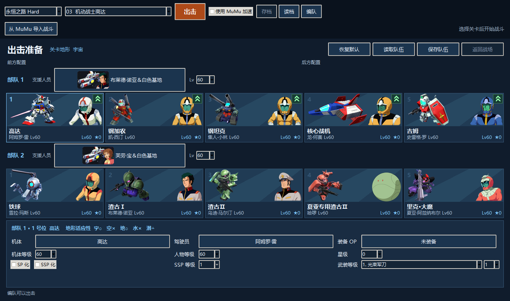
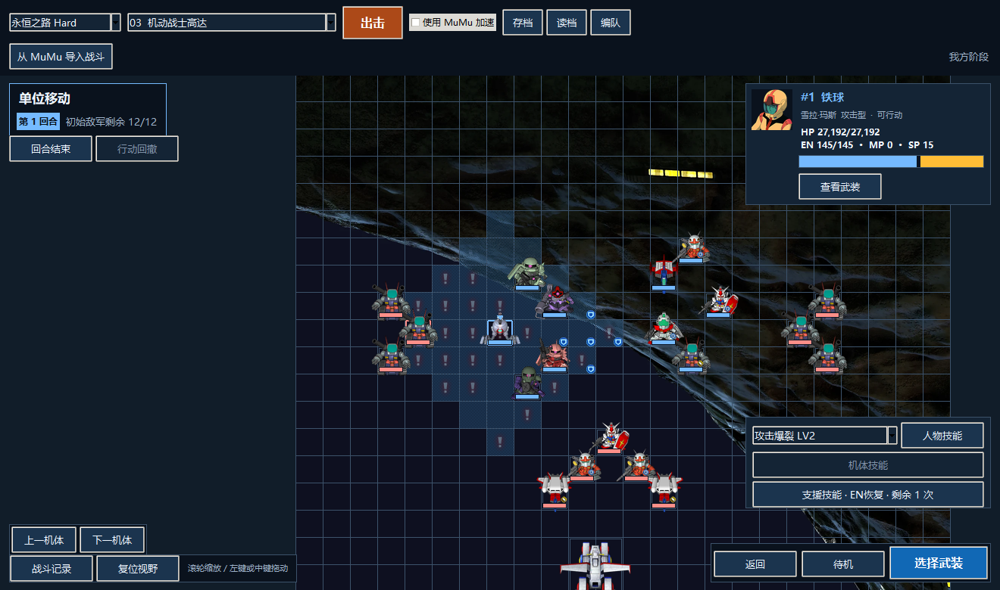
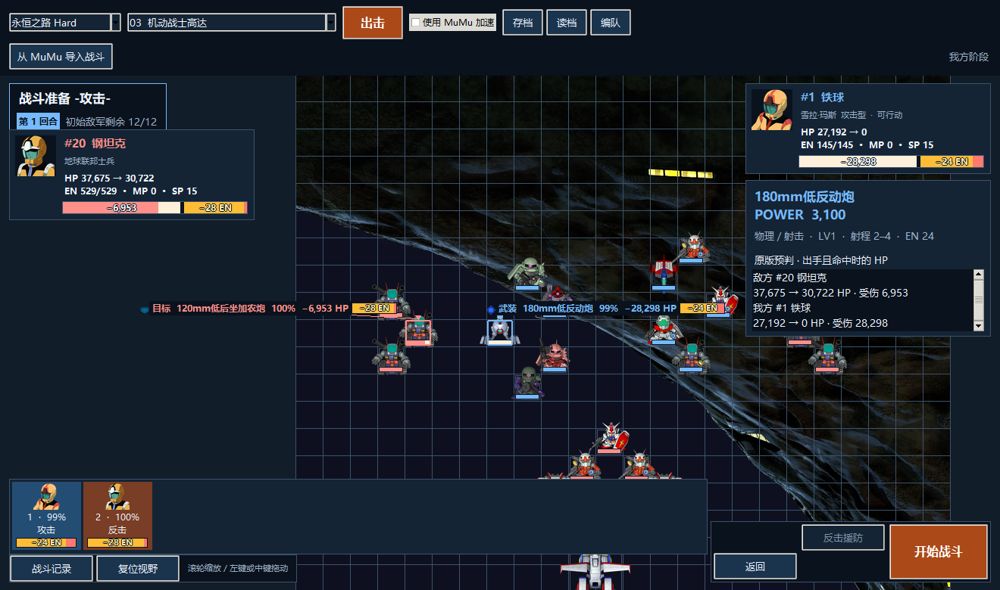
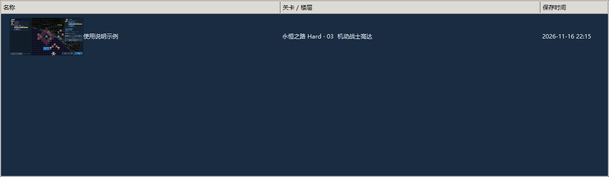

# SD 高达 G 世代 永恒 · 战斗模拟使用说明

本文以 v0.1.2 为例。截图使用本地测试编队，关卡为永恒之路 Hard「机动战士高达」。

## 1. 安装与启动

在 Windows x64 电脑上下载轻量包或全量包，解压后双击 `setup.cmd`。轻量包首次运行会下载基础资源，全量包已带基础资源。两种版本都会在打开窗口前检查热更新，并安装缺少的依赖。[GitHub 发布页](https://github.com/Torfaen/gget-battle-simulator/releases/tag/v0.1.2)

启动器会优先使用可连接的 MuMu，否则配置 QEMU。想明确使用 QEMU，可以在程序目录运行 `.\setup.cmd -Backend QEMU`。

如果旧安装的数据目录在别处，或旁边有多个 `-local`，首次启动新版时可以指定旧 `setup.log` 所在的目录。启动器会记住这个位置，之后照常双击即可。

```powershell
.\setup.cmd -DataDir 'D:\Games\gget-battle-simulator-v0.1.1-local'
```

## 2. 选关与编队

1. 在窗口左上选择「永恒之路 Hard」和「03 机动战士高达」。
2. 点击「编队」检查队伍。首次体验可以直接用预置队伍。要换机体或驾驶员，先点队伍里的卡片，再点下方对应按钮。选择器支持按名称或 ID 搜索。
3. 确认底部显示「编队可以出击」，再点上方的「出击」。



## 3. 手操战斗

点击我方机体，再点击地图上标出的可移动格。滚轮缩放地图，按住左键或中键拖动视野。

要攻击时，点右下角「选择武装」，选择目标和武装，再点「攻击」查看交战预判。不出手时可以点「待机」。我方操作完成后，点左上角「回合结束」。敌方攻击时，根据弹出的选项选择反击、防御或回避。



预判页会显示行动顺序、命中率、预计伤害和 EN 消耗。下图中的铁球预计会被反击击破，可以点「返回」调整打法。确认要打时，再点「开始战斗」。



## 4. 存档、读档与回撤

- **保存战斗**。等当前行动结算后，点顶部「存档」，输入名称并点「保存」。
- **继续战斗**。点顶部「读档」，再点击列表里的存档记录。
- **撤回行动**。左上角「行动回撤」可用时，点击即可回到上一段可回撤的战斗状态。
- **复用编队**。在出击准备界面使用「保存队伍」和「读取队伍」。



## 5. 从 MuMu 导入战斗

1. 打开已连接 ADB 的 MuMu，并进入《SD 高达 G 世代 永恒》国际版 **2.8.0** 的战斗。
2. 等行动结算，回到我方阶段的战场地图。
3. 在战斗模拟窗口左上点击「从 MuMu 导入战斗」。若当前模拟对局需要保留，先存档再确认导入。

导入读取游戏最近写盘的检查点，可以从我方回合中途的已结算盘面接着打。若导入后回到开局，先确认游戏已经写入后续进度。续战时随机数由后端初始化，敌方后续行动和交战结果可能与 MuMu 原局不同。

**排查位置**。配置或下载失败时，查看数据目录里的 `setup.log`。如果提示未检测到已连接 ADB 的 MuMu，先确认目标实例已启动且 ADB 能连接，再重试导入。
